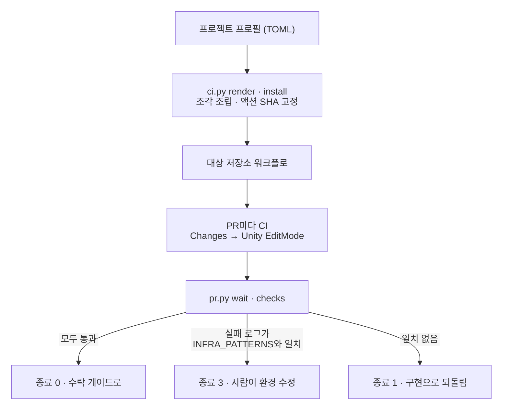

# CI 검증과 실패 원인 분류

**담당자:** 최성원 — CI 워크플로 생성·점검(`ci.py`)과 CI 결과 판정(`pr.py`)

프로젝트 프로필(TOML)에서 GitHub Actions 워크플로를 만들어 대상 Unity 저장소에 설치하고, PR 전에 설치된 워크플로가 프로필과 같은지 점검합니다. CI가 실패하면 `pr.py`가 실패한 작업 로그를 정규식으로만 대조해, 코드 실패는 구현 단계로 되돌리고 인프라 실패는 사람에게 넘깁니다.

- **발췌** [프로필에서 워크플로 생성과 점검](#프로필에서-워크플로-생성과-점검) · [Unity EditMode 작업 조각](#unity-editmode-작업-조각) · [실패 원인 분류](#실패-원인-분류)
- **자료 범위** 비공개 원본에서 발췌한 내용입니다.
- [생략 및 재구성한 내용](#생략-및-재구성한-내용)

## 코드



**ci.py:** 프로필의 조각 이름으로 `ci-templates/<조각>/job.yml`을 읽어 워크플로를 조립하고, 대상 저장소의 워크플로·시크릿 이름을 점검합니다. **pr.py:** 검사가 등록될 때까지 기다린 뒤 결과를 종료 코드로 정합니다.

인프라 실패(러너 디스크 부족, Unity 로그인 실패 등)까지 구현으로 되돌리면, 에이전트가 고칠 코드도 없이 재시도 횟수만 소모합니다. 그래서 실패 원인을 코드와 인프라로 나눕니다.

### 프로필에서 워크플로 생성과 점검

```python
# ci.py: 작업 본문은 조각 파일이고, 조각이 어느 작업용인지 template.toml로 확인한다.
def fragment(name: str, target: str) -> tuple[str, dict[str, Any]]:
    if not isinstance(name, str) or not FRAGMENT_RE.match(name):
        raise Blocked(f"CI 조각 이름 형식 오류: {name!r}")
    directory = TEMPLATES / name
    if not (directory / "job.yml").is_file() or not (directory / "template.toml").is_file():
        raise Blocked(f"CI 조각이 없다: ci-templates/{name}")
    with (directory / "template.toml").open("rb") as f:
        meta = tomllib.load(f)
    if meta.get("target") != target:
        raise Blocked(f"CI 조각 {name}은 {meta.get('target')}용이다({target}에 쓸 수 없다)")
    return (directory / "job.yml").read_text(encoding="utf-8"), meta


# 채우지 못한 자리가 남으면 잘못된 워크플로를 설치하지 않도록 멈춘다.
def fill(text: str, values: dict[str, str], where: str) -> str:
    for k, v in values.items():
        text = text.replace(f"<<{k}>>", v)
    left = re.findall(r"<<\w+>>", text)
    if left:
        raise Blocked(f"CI 조각 {where}에 채우지 못한 자리가 있다: {', '.join(sorted(set(left)))}")
    return text


def check(profile: dict[str, Any], runner: Runner, branch: str | None = None) -> list[str]:
    """문제 목록. 비면 통과. branch를 주면 그 브랜치의 워크플로를 본다."""
    problems: list[str] = []
    base = str(profile_get(profile, "repo.base", "main"))
    where = branch or base
    hint = "ci.py install로 둔다" if where == base else f"{base}를 {where}에 병합하거나 ci.py install 뒤 다시 병합한다"
    for path, want in workflows(profile):
        p = runner(["git", "-C", str(repo_of(profile)), "show", f"{where}:{path}"], None, 30)
        if p.returncode != 0:
            problems.append(f"{where} 브랜치에 {path}가 없다. {hint}")
        elif norm_text(p.stdout) != want:
            problems.append(f"{where}의 {path}가 지금 프로필로 만든 결과와 다르다(오래됨). {hint}")
    need = required_secrets(profile)
    if need:
        # 시크릿은 이름만 확인한다. 값은 읽지 않는다.
        p = runner(["gh", "secret", "list", "--repo", str(profile_get(profile, "repo.github")), "--json", "name"], None, 60)
        if p.returncode != 0:
            problems.append("gh secret list 실패(gh 로그인과 저장소 권한을 확인한다)")
        else:
            try:
                have = {s.get("name") for s in json.loads(p.stdout or "[]")}
            except json.JSONDecodeError:
                have = set()
                problems.append("gh secret list 출력 해석 실패")
            missing = [s for s in need if s not in have]
            if missing:
                problems.append(f"저장소 시크릿 없음: {', '.join(missing)}. 사용자가 gh secret set으로 등록한다(값은 대화로 받지 않는다)")
    return problems
```

### Unity EditMode 작업 조각

```yaml
# ci-templates/unity-editmode/job.yml: ci.py render가 작업 본문으로 넣는다. 액션은 커밋 SHA로 고정한다.
runs-on: ubuntu-latest
timeout-minutes: 60
steps:
  # Unity 6 이미지가 커서 러너 디스크가 모자란다(첫 실행: no space left on device). GameCI 문제 해결 문서 권장.
  - uses: jlumbroso/free-disk-space@ceedf095f4ec1a097402bc6bd80831f2e1a6fde6 # v2.0.0
  - uses: actions/checkout@3d3c42e5aac5ba805825da76410c181273ba90b1 # v7.0.1
    with:
      lfs: true
  - uses: actions/cache@55cc8345863c7cc4c66a329aec7e433d2d1c52a9 # v6.1.0
    with:
      path: Library
      key: Library-${{ hashFiles('Assets/**', 'Packages/**', 'ProjectSettings/**') }}
      restore-keys: |
        Library-
  - uses: game-ci/unity-test-runner@fa6ced25861c16ef56187828c43f76d00df43a23 # v4.3.2
    id: tests
    env:
      UNITY_LICENSE: ${{ secrets.UNITY_LICENSE }}
      UNITY_EMAIL: ${{ secrets.UNITY_EMAIL }}
      UNITY_PASSWORD: ${{ secrets.UNITY_PASSWORD }}
    with:
      testMode: EditMode
      unityVersion: auto
      githubToken: ${{ secrets.GITHUB_TOKEN }}
      checkName: EditMode Test Results
  - uses: actions/upload-artifact@cf430e030ddbb5b0abf93d22962f4752f3646cd9 # v7.0.2
    if: always()
    with:
      name: editmode-results
      path: ${{ steps.tests.outputs.artifactsPath }}
```

```toml
# ci-templates/unity-editmode/template.toml: 조각이 쓰는 대상과 필요한 시크릿 이름
target = "unity"
secrets = ["UNITY_LICENSE", "UNITY_EMAIL", "UNITY_PASSWORD"]
```

### 실패 원인 분류

```python
# pr.py: 코드가 아니라 실행 환경 때문에 실패한 CI. 실패한 작업 로그에서 찾는다. 로그는 데이터이고 맞춰 보기만 한다.
# 패턴은 실제 CI에서 받은 실패 로그에서만 추가한다.
INFRA_PATTERNS = {
    "disk": re.compile(r"no space left on device", re.IGNORECASE),
    "unity_login": re.compile(r"UnityConnectLoginRequest: Failed to login", re.IGNORECASE),
    "unity_license": re.compile(r"Failed to activate (ULF|entitlement) license|Access token is unavailable", re.IGNORECASE),
    "docker_pull": re.compile(r"Error response from daemon|failed to register layer|toomanyrequests", re.IGNORECASE),
    "network": re.compile(r"Could not resolve host|Temporary failure in name resolution|ECONNRESET", re.IGNORECASE),
}
REGISTER_WAIT = 600  # PR 갱신 직후 검사가 등록될 때까지 기다리는 상한(초)
REGISTER_POLL = 15


def infra_causes(runner: Runner, gh_repo: str, failed: list[dict[str, Any]]) -> list[str]:
    """실패한 검사의 작업 로그에서 인프라 원인 이름을 찾는다. 찾지 못하면 빈 목록(코드 실패로 본다)."""
    runs = sorted({m.group(1) for i in failed if (m := RUN_ID_RE.search(str(i.get("link", ""))))})
    found: set[str] = set()
    for run_id in runs:
        p = runner(["gh", "run", "view", run_id, "--repo", gh_repo, "--log-failed"], None, 300)
        if p.returncode != 0:
            continue
        found |= {name for name, rx in INFRA_PATTERNS.items() if rx.search(p.stdout)}
    return sorted(found)


def pr_checks(runner: Runner, number: int, gh_repo: str, watch: bool,
              sleep: Callable[[float], None] = time.sleep) -> tuple[int, list[dict[str, Any]], dict[str, Any]]:
    """PR 하나의 CI 판정. 종료 코드, 검사 목록, ci.json 내용."""
    info = {"number": number}
    if watch:
        # `gh pr checks --watch`는 검사가 아직 없으면 바로 끝난다(PR 갱신 직후 3초). 등록될 때까지 기다린다.
        waited = 0.0
        while not list_checks(runner, info["number"], gh_repo) and waited < REGISTER_WAIT:
            sleep(REGISTER_POLL)
            waited += REGISTER_POLL
        runner(["gh", "pr", "checks", str(info["number"]), "--repo", gh_repo, "--watch", "--interval", "30"], None, 7200)
    items = list_checks(runner, info["number"], gh_repo)
    buckets = {i.get("bucket") for i in items}
    result: dict[str, Any] = {"checks": items}
    code = EXIT_OK
    if not items:
        code = EXIT_BLOCKED  # CI가 없거나 등록되지 않음
    elif "fail" in buckets or "cancel" in buckets:
        causes = infra_causes(runner, gh_repo, [i for i in items if i.get("bucket") in ("fail", "cancel")])
        if causes:
            result["infra"] = causes
            code = EXIT_BLOCKED  # 재구현이 아니라 사람이 환경을 고친다
        else:
            code = EXIT_FAIL
    elif "pending" in buckets:
        code = EXIT_BLOCKED
    return code, items, result
```

```python
# tests/test_verify_pr.py: 실제 실패 로그 문구로 분류를 시험한다(네트워크 없이 gh 호출을 가짜로 바꾼다).
@pytest.mark.parametrize(("log", "code", "infra"), [
    ("docker: failed to register layer: write /opt/unity/x: no space left on device", EXIT_BLOCKED, ["disk", "docker_pull"]),
    (("UnityConnectLoginRequest: Failed to login - please check your username or password\n"
      "[Licensing::Module] Error: Failed to activate ULF license"), EXIT_BLOCKED, ["unity_license", "unity_login"]),
    ("Test results: 3 passed, 1 failed\nExpected: True But was: False", EXIT_FAIL, []),
    ("", EXIT_FAIL, []),
])
def test_pr_checks_separates_infra_from_code(world: dict[str, object], log: str, code: int, infra: list[str]) -> None:
    """실패 로그가 인프라 원인이면 재구현(종료 1)이 아니라 사람이 고칠 종료 3."""
    root, _ = passed(world)
    pr.run(["create", "SAN-3"], root, Gh())
    gh = Gh(checks=[{"name": "Changes", "bucket": "pass", "link": RUN},
                    {"name": "Unity", "bucket": "fail", "link": RUN}], log=log)
    assert pr.run(["checks", "SAN-3"], root, gh) == code
    assert read_json(root / "runs/SAN-3/ci.json").get("infra", []) == infra
```

## 생략 및 재구성한 내용

- 원본: `1Seong/UnityLoopInner`의 `scripts/ci.py` (`fragment`, `fill`, `check`), `ci-templates/unity-editmode/job.yml`·`template.toml`, `scripts/pr.py` (`INFRA_PATTERNS`, `REGISTER_WAIT`, `REGISTER_POLL`, `infra_causes`, `pr_checks`), `tests/test_verify_pr.py` (`test_pr_checks_separates_infra_from_code`). 기준 커밋: `3968a7b117404e877375f0c2699137c2e6501889`.
- `ci.py`의 워크플로 조립(`render`, `jobs`)과 `changes` 작업의 경로 판정 스크립트, 릴리스 워크플로, `install`은 생략했습니다. `fragment` 위 주석, `fill` 위 주석, 시크릿 확인 주석, 시험 블록 첫 줄 주석은 이 문서에서 덧붙였습니다.
- `check`·`pr_checks`·시험 함수의 docstring과 `INFRA_PATTERNS` 위 주석, `pr_checks`의 `--watch` 대기 주석에서 원본의 결정 번호(`I-D15` 등), 실측 실행 번호, 내부 이슈 키를 뺐습니다. "패턴은 실제 CI에서 받은 실패 로그에서만 추가한다"는 원본 결정 문서의 규칙을 옮긴 주석입니다. `job.yml`의 디스크 주석에서도 이슈 키를 뺐습니다.
- `job.yml`·`template.toml` 첫 줄 주석은 이 문서에서 덧붙였습니다(`template.toml` 원본 주석의 요약).
- `pr.py`의 `list_checks`, `checks`(결과를 `ci.json`에 쓰는 부분), PR 생성·머지는 생략했습니다. 시험의 `RUN` 상수와 가짜 `Gh` 클래스, `passed` 준비 함수, 뒤쪽의 `gh run view` 호출 확인은 생략했습니다.
- 시험 데이터의 이슈 키(`SAN-3`)는 샌드박스 프로젝트 키이며 원본 그대로 두었습니다.
- 프로필 파일, `ulib`, gh CLI에 의존하므로 단독 실행되지 않습니다.
