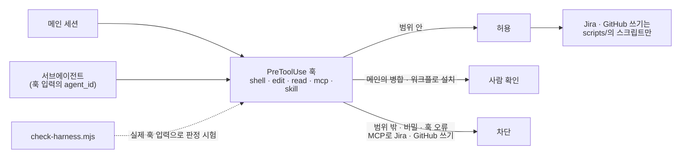

# 훅 기반 쓰기 범위와 외부 쓰기 가드

**담당자:** 최성원 — 훅 5종, 에이전트별 쓰기 범위, 고정 스킬, 하네스 시험 설계

메인 세션과 서브에이전트의 도구 호출은 실행 전에 해당 PreToolUse 훅을 거쳐 허용·사람 확인·차단으로 나뉩니다. 서브에이전트는 `ownership.json`에 적힌 경로만 쓸 수 있고, Jira·GitHub 쓰기 도구는 받지 않습니다. 훅이 판정할 수 없으면 차단합니다.

- **발췌** [훅 등록과 공통 판정](#훅-등록과-공통-판정) · [에이전트별 쓰기 범위](#에이전트별-쓰기-범위) · [외부 쓰기와 최종 승인](#외부-쓰기와-최종-승인) · [하네스 판정 시험](#하네스-판정-시험)
- **자료 범위** 비공개 원본에서 발췌한 내용입니다.
- [생략 및 재구성한 내용](#생략-및-재구성한-내용)

## 코드



**settings.json:** 도구 종류별로 훅을 등록하고, 훅이 실패하면 차단하게 합니다. **lib.mjs:** 판정 출력, 호출 주체 판별, 예외 시 차단을 공통으로 맡습니다. **guard-edit.mjs:** 파일 쓰기를 판정합니다. **check-harness.mjs:** 훅 스크립트를 실제 입력으로 실행해 판정을 시험합니다.

훅은 사고를 줄이는 장치이지 보안 경계가 아닙니다. 그래서 변경 범위 diff 검사와 사람의 수락 게이트를 함께 유지합니다.

### 훅 등록과 공통 판정

```jsonc
// .claude/settings.json (PreToolUse 일부)
"PreToolUse": [
  {
    "matcher": "Write|Edit|MultiEdit|NotebookEdit",
    "hooks": [
      { "type": "command", "command": "node", "args": ["${CLAUDE_PROJECT_DIR}/.claude/hooks/guard-edit.mjs"], "timeout": 10, "onFailure": "block" }
    ]
  },
  {
    "matcher": "Skill",
    "hooks": [
      { "type": "command", "command": "node", "args": ["${CLAUDE_PROJECT_DIR}/.claude/hooks/guard-skill.mjs"], "timeout": 10, "onFailure": "block" }
    ]
  }
  // Bash|PowerShell → guard-shell, Read|Grep|Glob → guard-read, mcp__.* → guard-mcp도 같은 형식
]
```

```js
// .claude/hooks/lib.mjs: 훅 공용 함수. 판정할 수 없으면 차단한다(exit 2).
export function guarded(main) {
  try {
    main();
  } catch (err) {
    process.stderr.write(`훅 오류로 차단합니다: ${err.message}\n`);
    process.exit(2);
  }
}

export function decide(permissionDecision, reason) {
  process.stdout.write(
    JSON.stringify({
      hookSpecificOutput: {
        hookEventName: 'PreToolUse',
        permissionDecision,
        permissionDecisionReason: reason,
      },
    }),
  );
  process.exit(0);
}

// 서브에이전트 판별은 agent_id로 한다. agent_type만 있으면 `--agent`로 시작한 메인일 수 있다.
// 반환: null(메인) 또는 에이전트 이름. agent_id가 있는데 이름이 없으면 빈 문자열(알 수 없는 에이전트).
export function callerAgent(input) {
  if (!input.agent_id) return null;
  return String(input.agent_type ?? '');
}
```

### 에이전트별 쓰기 범위

```jsonc
// .claude/hooks/ownership.json (일부). <KEY>는 현재 이슈 키, "@scope"는 계획 단계가 정한 대상 저장소 경로
{
  "discoverer": ["runs/<KEY>/discovery.md"],
  "planner": ["runs/<KEY>/plan.md", "runs/<KEY>/scope.json", "runs/<KEY>/acceptance.json"],
  "implementer": ["runs/<KEY>/design-notes.md", "runs/<KEY>/builders.json", "@scope"],
  "evaluator": ["runs/<KEY>/evaluation.json"]
}
```

```js
// .claude/hooks/guard-edit.mjs: 파일 쓰기 가드
guarded(() => {
  const input = readInput();
  const raw = input.tool_input?.file_path ?? input.tool_input?.notebook_path;
  if (!raw) decide('deny', '쓰기 경로를 확인할 수 없습니다.');

  const root = projectDir(input);
  const path = normalizePath(raw, input.cwd || root);
  const rel = relativeToRoot(path, root);
  const shown = rel ?? path;

  if (isSecretPath(path)) decide('deny', `비밀 파일은 에이전트가 쓸 수 없습니다: ${shown}`);
  if (hasSegment(path, ['.git'])) decide('deny', '.git 내부는 직접 수정할 수 없습니다.');

  const agent = callerAgent(input);
  if (agent === null) return; // 메인 세션: 실수 방지 규칙만 적용

  // 저장소 안은 루트 기준 상대 경로로 본다. 작업 트리가 `<원래 저장소>/.claude/worktrees/` 아래에 있어도
  // `runs/`가 막히지 않게 한다. 저장소 밖(원래 체크아웃, 다른 작업 트리, 대상 저장소)은 절대 경로 전체로 본다.
  if (hasSegment(rel ?? path, ['.claude']) || `/${shown}`.toLowerCase().endsWith('/.mcp.json')) {
    decide('deny', `서브에이전트는 .claude/와 .mcp.json을 쓸 수 없습니다: ${shown}`);
  }

  const ownershipFile = join(dirname(fileURLToPath(import.meta.url)), 'ownership.json');
  const allowed = JSON.parse(readFileSync(ownershipFile, 'utf8'))[agent];
  // 목록에 없는 에이전트는 쓰기가 모두 막힌다.
  if (!agent || agent.startsWith('_') || !Array.isArray(allowed)) {
    decide('deny', `쓰기 범위가 정의되지 않은 에이전트입니다: ${agent || '(이름 없음)'}`);
  }

  const key = activeRun(root);
  if (!key) decide('deny', '현재 실행 중인 이슈(runs/ACTIVE.json)가 없어 서브에이전트 쓰기를 허용할 수 없습니다.');

  for (const entry of allowed) {
    if (entry === '@scope') {
      const scope = readScope(root, key);
      if (!scope || rel !== null) continue; // 대상 저장소 쓰기만 허용. 이 파이프라인 저장소는 @scope로 열 수 없다.
      const target = relativeToRoot(path, scope.root);
      if (target !== null && scope.paths.some((p) => underPrefix(target, p))) return;
    } else if (rel !== null && underPrefix(rel, entry.replaceAll('<KEY>', key))) {
      return;
    }
  }
  decide('deny', `${agent}의 쓰기 범위 밖입니다: ${shown}. 허용: ${allowed.join(', ').replaceAll('<KEY>', key)}`);
});
```

### 외부 쓰기와 최종 승인

```js
// .claude/hooks/guard-mcp.mjs: 외부 쓰기는 파이프라인 스크립트(jira.py, pr.py 등)만 한다.
// 서브에이전트는 읽기 도구만, 메인 세션도 Jira·GitHub·Supabase 쓰기 도구는 쓸 수 없다.
guarded(() => {
  const input = readInput();
  const name = String(input.tool_name ?? '');
  if (!name.startsWith('mcp__')) return;
  const all = words(name.split('__').slice(2).join('__'));
  const rest = [...all];
  while (rest.length > 1 && SERVICE_PREFIX.has(rest[0])) rest.shift();
  const isRead = READ_VERBS.has(rest[0]) && !rest.some((w) => WRITE_WORDS.has(w));

  if (callerAgent(input) !== null) {
    if (!isRead) decide('deny', `서브에이전트는 읽기 MCP 도구만 쓸 수 있습니다: ${name}`);
    return;
  }
  if (isRead) return;
  if (all.some((w) => CRITICAL.has(w))) decide('deny', `Jira·GitHub·Supabase 쓰기는 파이프라인 스크립트로만 합니다: ${name}`);
});
```

```js
// .claude/hooks/guard-shell.mjs: 메인 세션은 사람의 최종 승인이 필요한 실행만 확인(ask)으로 넘긴다.
const SCRIPT_ASK = {
  'ci.py': ['install'], // 대상 저장소 기본 브랜치에 PR 없이 커밋·푸시한다
  'promote.py': ['merge'], // 작업 브랜치를 기본 브랜치에 병합한다
};

// 서브에이전트 허용 목록: 읽기 명령만. 목록 밖 명령, 리다이렉션, 명령 치환은 모두 차단한다.
const READ_ONLY = new Set(['ls', 'dir', 'pwd', 'cd', 'cat', 'type', 'head', 'tail', 'wc', 'grep', 'rg', 'cut', 'sort', 'uniq', 'find', 'which', 'echo', 'get-content', 'get-childitem', 'select-string', 'test-path']);
const GIT_READ = new Set(['status', 'diff', 'log', 'show', 'ls-files', 'rev-parse', 'blame', 'merge-base', 'grep']);

guarded(() => {
  const input = readInput();
  const command = String(input.tool_input?.command ?? '');
  bashEscapes = input.tool_name === 'Bash';
  const agent = callerAgent(input);
  const { result, parsed } = checkCommand(command);
  if (result.decision === 'deny') decide('deny', result.reason);
  if (agent !== null) {
    // 메인이라면 사람에게 물을 명령도 서브에이전트에게는 차단한다. gh·git push 같은 쓰기는 허용 목록에 없다.
    if (result.decision === 'ask') decide('deny', `서브에이전트는 확인이 필요한 명령을 실행할 수 없습니다: ${result.reason}`);
    const sub = checkSubagent(parsed, agent);
    if (sub.decision === 'deny') decide('deny', sub.reason);
    return;
  }
  if (result.decision === 'ask') decide('ask', result.reason);
});
```

### 하네스 판정 시험

기준 커밋에서 하네스 판정 시험 474건이 모두 통과했습니다.

```js
// scripts/check-harness.mjs: 네트워크와 모델 호출 없이 훅 스크립트를 실제 입력으로 실행해 판정을 확인한다.
function runHook(script, input, projectDir = root) {
  const r = spawnSync('node', [join(hooks, script)], {
    input: JSON.stringify(input),
    encoding: 'utf8',
    env: { ...process.env, CLAUDE_PROJECT_DIR: projectDir },
  });
  if (r.status === 2) return 'deny';
  if (r.status !== 0) return `error:${r.stderr}`;
  if (!r.stdout.trim()) return 'none';
  return JSON.parse(r.stdout).hookSpecificOutput.permissionDecision;
}
const sub = (agent) => ({ agent_id: 'a1b2c3', agent_type: agent });

function editCases(cases) {
  for (const [expected, who, filePath] of cases) {
    const input = { tool_name: 'Write', cwd: pipe, tool_input: { file_path: filePath, content: 'x' }, ...(who !== null ? sub(who) : {}) };
    const actual = runHook('guard-edit.mjs', input, pipe);
    check(actual === expected, `guard-edit(${who ?? 'main'}) ${filePath}: 기대 ${expected}, 실제 ${actual}`);
  }
}

// ACTIVE가 없으면 서브에이전트 쓰기는 전부 막힌다
editCases([
  ['deny', 'discoverer', `${pipe}/runs/SAN-3/discovery.md`],
  ['none', null, `${pipe}/scripts/state.py`],
]);

// 고정 스킬: 에이전트가 쓰는 외부 스킬은 복사해 두고, 시작 때 기록한 해시와 내용이 같은지 매번 대조한다.
for (const [name, entry] of Object.entries(manifest)) {
  const dir = join(root, '.claude/skills', name);
  check(existsSync(join(dir, 'SKILL.md')), `고정 스킬 없음: ${name}`);
  if (!existsSync(join(dir, 'SKILL.md'))) continue;
  check(treeHash(dir) === entry.sha256, `고정 스킬 해시 불일치: ${name} (내용이 바뀜. 검토 후 pin_skill.py --replace)`);
}
```

## 생략 및 재구성한 내용

- 원본: `1Seong/UnityLoopInner`의 `.claude/settings.json` (`hooks.PreToolUse`), `.claude/hooks/lib.mjs` (`guarded`, `decide`, `callerAgent`), `.claude/hooks/ownership.json`, `.claude/hooks/guard-edit.mjs` (본문 전체), `.claude/hooks/guard-mcp.mjs` (본문), `.claude/hooks/guard-shell.mjs` (`SCRIPT_ASK`, `READ_ONLY`, `GIT_READ`, 본문), `scripts/check-harness.mjs` (`runHook`, `sub`, `editCases`, 3-1 시험, 고정 스킬 해시 대조). 기준 커밋: `3968a7b117404e877375f0c2699137c2e6501889`.
- `guard-mcp.mjs`·`guard-shell.mjs` 블록 첫 주석은 원본 머리말을 요약한 것이고, 서브에이전트 차단 분기 위 주석은 이 문서에서 덧붙였습니다. 원본 주석의 결정 번호(`I-D14` 등)는 뺐습니다. `guard-mcp.mjs`의 단어 목록(`SERVICE_PREFIX`·`READ_VERBS`·`WRITE_WORDS`·`CRITICAL`)과 `words`, 그 밖의 쓰기를 묻지 않는다는 끝 주석은 생략했습니다.
- `guard-shell.mjs`의 셸 구문 해석(`shell-parse.mjs`), git·gh 하위 명령 판정(강제 푸시·검증 우회 차단, 기본 브랜치 직접 푸시와 `gh pr merge` 확인), 비밀값 검사, `checkSubagent`·`subagentAllows` 본문은 생략했습니다.
- 하네스 시험 474건은 원본 `docs/STATUS.md`에 기록된 기준 커밋 시점의 결과입니다.
- `settings.json`은 PreToolUse 다섯 항목 중 두 개만 남기고 나머지는 주석으로 줄였습니다. JSON에는 주석을 쓸 수 없어 `jsonc`로 표기했습니다.
- `ownership.json`은 `_comment`와 `solo`·`security-reviewer` 항목을 빼고 한 줄 배열로 줄였습니다. 첫 줄 설명은 원본 `_comment`의 요약입니다.
- `guard-edit.mjs`의 import 문과 `hasSegment`·`underPrefix` 보조 함수, `lib.mjs`의 경로 정규화·비밀 파일 판별·`scope.json` 검사는 생략했습니다. `allowed` 위 주석 한 줄과 블록 첫 줄의 위치 주석은 이 문서에서 덧붙였습니다.
- `guard-read.mjs`·`guard-skill.mjs`의 본문은 싣지 않았습니다.
- `check-harness.mjs`의 임시 저장소 준비, `check` 함수, 나머지 시험 묶음, `treeHash` 본문은 생략했습니다. 첫 줄 주석은 원본 머리말 둘째 줄에 파일 위치를 붙인 것이고, 시험 묶음 번호(`3-1.`)는 뺐습니다. 고정 스킬 블록 위 주석은 이 문서에서 덧붙였습니다.
- 시험 데이터의 이슈 키(`SAN-3`)는 샌드박스 프로젝트 키이며 원본 그대로 두었습니다.
- Claude Code 훅 입력 형식과 원본의 경로 구성에 의존하므로 단독 실행되지 않습니다.
