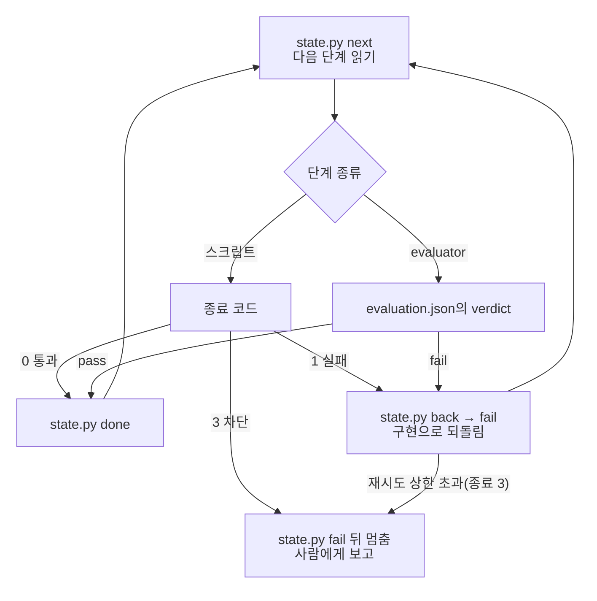

# 이슈 단위 단계 흐름과 판정 분리

**담당자:** 최성원 — 단계 순서·재시도 관리(`state.py`)와 `/issue` 절차 설계

`/issue` 스킬은 다음에 할 일을 스스로 정하지 않고, `state.py`가 기록한 다음 단계만 진행합니다. 스크립트 단계는 종료 코드로, 평가 단계는 `evaluator`의 판정 파일로 결과를 넘깁니다. 실패하면 실패 파일 위치와 확인한 사실만 붙여 구현 단계로 되돌립니다.

- **발췌** [단계 순서와 재시도 상한](#단계-순서와-재시도-상한) · [수락 게이트와 되돌리기](#수락-게이트와-되돌리기) · [종료 코드 처리 규칙](#종료-코드-처리-규칙)
- **자료 범위** 비공개 원본에서 발췌한 내용입니다.
- [생략 및 재구성한 내용](#생략-및-재구성한-내용)

## 코드



**state.py:** 이슈마다 단계 순서, 단계별 상태와 시도 횟수를 `runs/KEY/state.json`에 기록하고, 순서에 맞는 요청만 받습니다. **`/issue` 스킬(SKILL.md):** 메인 세션이 따르는 절차입니다. 판정은 하지 않고, 종료 코드와 판정 파일을 `state.py` 명령으로 옮깁니다.

메인 세션이 결과를 해석하지 않게 해서, 에이전트 출력이 길거나 흔들려도 같은 이슈가 같은 순서와 기준으로 진행됩니다.

### 단계 순서와 재시도 상한

```python
# state.py: 표준 모드의 단계 순서. 사람 게이트(accept) 뒤로는 되돌리지 않는다.
STANDARD = [
    "fetch", "extract", "preflight", "discover", "plan", "scope_check", "jira_in_progress",
    "implement", "verify", "evaluate", "security_review", "pr", "ci", "accept", "merge", "deploy", "close",
]
OPTIONAL = {"security_review", "deploy"}
# 실패 뒤 돌아갈 수 있는 단계. 사람 게이트 이후로는 돌아가지 않는다.
BACK_TARGETS = {"plan", "implement", "solo", "verify"}
# 재시도 상한을 적용하는 단계(프로필 limits.retries, 기본 2)
RETRY_STEPS = {"discover", "plan", "implement", "solo", "verify", "evaluate", "ci"}


def next_step(state: dict[str, Any]) -> str | None:
    for name in state["order"]:
        if state["steps"][name]["status"] not in ("done", "skipped"):
            return name
    return None


# 순서를 건너뛴 요청과 상한을 넘어 차단된 단계는 받지 않는다.
def require_next(state: dict[str, Any], step: str) -> None:
    if step not in state["steps"]:
        raise UsageError(f"이 모드에 없는 단계다: {step}")
    expected = next_step(state)
    if step != expected:
        raise UsageError(f"순서가 아니다: 다음 단계는 {expected}, 요청은 {step}")
    if state["steps"][step]["status"] == "blocked":
        raise Blocked(f"{step}은 재시도 상한을 넘어 차단됐다. 사람이 확인한 뒤 back으로 되돌린다.")


def fail_step(state: dict[str, Any], step: str, reason: str, root: Path) -> int:
    require_next(state, step)
    entry = state["steps"][step]
    entry["attempts"] += 1
    limit = state["retries"] if step in RETRY_STEPS else 0
    blocked = entry["attempts"] > limit
    record(state, step, "blocked" if blocked else "failed", reason)
    save(state, root)
    if blocked:
        # 같은 실패를 에이전트가 무한히 반복하지 않도록 상한에서 사람에게 넘긴다.
        print(f"{step} 실패 {entry['attempts']}회로 상한({limit})을 넘었다. 사람에게 넘긴다.", file=sys.stderr)
        return EXIT_BLOCKED
    print(f"{step} 실패 {entry['attempts']}/{limit + 1}회")
    return EXIT_OK


def back_to(state: dict[str, Any], step: str, root: Path) -> None:
    if step not in BACK_TARGETS or step not in state["steps"]:
        raise UsageError(f"되돌릴 수 없는 단계다: {step}")
    order = state["order"]
    start = order.index(step)
    current = next_step(state)
    if current is None or order.index(current) < start:
        raise UsageError(f"아직 {step}에 도달하지 않았거나 이미 끝났다")
    if order.index(current) > order.index("accept"):
        raise UsageError("수락 이후에는 되돌리지 않는다")
    for name in order[start:]:
        state["steps"][name]["status"] = "pending"  # 시도 횟수는 남긴다
    save(state, root)
```

### 수락 게이트와 되돌리기

```python
# state.py run(): 수락 게이트는 사람이 정한다. 거절하면 사유를 남기고 구현 단계로 되돌린다.
if args.cmd in ("accept", "reject"):
    current = next_step(state)
    if current != "accept":
        raise Blocked(f"{key}는 수락 단계가 아니다(다음: {current or 'finished'})")
    if args.cmd == "accept":
        record(state, "accept", "done", args.note)
        save(state, root)
        add_review(key, root, {"verdict": "accept", "note": args.note or ""})
        print(f"accept 완료. 다음: {next_step(state) or 'finished'}")
        return EXIT_OK
    reason = args.reason.strip()
    if not reason:
        raise UsageError("거절 사유가 비어 있다")
    target = impl_step(state)  # 표준 implement, 경량 solo
    # 재구현 에이전트는 사유를 대화가 아니라 runs/KEY/review.json 파일로 읽는다.
    add_review(key, root, {"verdict": "reject", "reason": reason})
    back_to(state, target, root)
    code = fail_step(state, target, f"수락 거절: {reason}", root)
    if code == EXIT_OK:
        print(f"{target}부터 다시 한다. 사유는 runs/{key}/review.json")
    return code
```

### 종료 코드 처리 규칙

```markdown
<!-- .claude/skills/issue/SKILL.md 발췌 -->
이 절차는 `scripts/`의 결정적 스크립트와 `.claude/agents/`의 서브에이전트를 순서대로 부른다.
순서와 재시도 횟수는 `state.py`가 정하고, 판정은 스크립트의 종료 코드가 정한다.
너(메인 세션)는 판정하지 않고 결과를 옮긴다.

| 종료 | 뜻 | 할 일 |
|---|---|---|
| 0 | 통과 | `state.py done KEY STEP` |
| 1 | 실패(재시도 대상) | 아래 단계별 "실패" 칸을 따른다 |
| 2 | 사용 오류 | 기록하지 않고 멈춘다. 절차나 스크립트의 결함으로 보고한다 |
| 3 | 차단(사람이 보완) | `state.py fail KEY STEP --reason "<stderr 한 줄>"` 뒤 멈추고, 무엇이 왜 필요한지 보고한다 |

**구현으로 되돌리기**(`→ 재구현`): 표준이면 `IMPL=implement`, 경량이면 `IMPL=solo`.
1. `state.py back KEY IMPL`
2. `state.py fail KEY IMPL --reason "<실패 파일과 한 줄 요약>"`. 종료 3이면 상한을 넘은 것이다. 멈추고 보고한다.
3. `IMPL` 단계부터 다시 한다. 에이전트에게 실패 파일 위치(`verify.json`, `evaluation.json`, `ci.json` 등)를 알려 준다.
   - 실패 파일과 대상 저장소 diff에서 **확인한 사실**을 한 줄로 덧붙여도 된다(예: "실패한 테스트 5개, 메시지 '...'"). 고치는 방법은 지시하지 않는다. 기준·범위·한도는 바꾸지 않는다.
```

## 생략 및 재구성한 내용

- 원본: `1Seong/UnityLoopInner`의 `scripts/state.py` (`STANDARD`, `OPTIONAL`, `BACK_TARGETS`, `RETRY_STEPS`, `next_step`, `require_next`, `fail_step`, `back_to`, `run`의 accept·reject 분기), `.claude/skills/issue/SKILL.md` (도입부, 종료 코드 처리, 구현으로 되돌리기). 기준 커밋: `3968a7b117404e877375f0c2699137c2e6501889`.
- 경량 모드 순서(`LIGHT`), `start`·`current`·`stop` 명령, 고정 스킬 해시 비교, `runs/ACTIVE.json` 관리, `record`·`save`·`add_review`·`impl_step` 본문, argparse 설정은 생략했습니다.
- 블록 첫 줄의 위치 주석, `require_next` 위 주석, `fail_step` 상한 주석, reject 분기의 두 주석은 이 문서에서 덧붙였습니다(`review.json` 주석은 원본 `add_review` docstring의 요약). 나머지 주석은 원본 그대로입니다.
- SKILL.md는 표와 규칙 일부만 옮겼고, 단계별 할 일 표와 수락 게이트 안내는 생략했습니다. SKILL.md 도입부와 3번 항목 끝, `RETRY_STEPS` 줄 끝에 있던 결정 번호 표기(`I-D9`, `I-D19`, `I-D12`)는 뺐습니다. 3번 항목의 예시 괄호는 두 예시 중 하나만 남겼습니다.
- `ulib`의 종료 코드 상수(`EXIT_OK`·`EXIT_BLOCKED`)와 예외(`Blocked`·`UsageError`), 프로필 파일에 의존하므로 단독 실행되지 않습니다.
